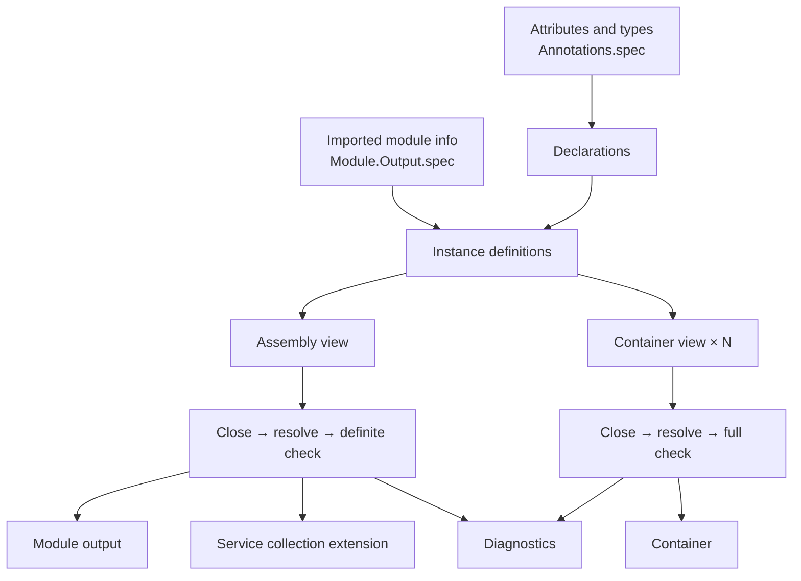

# Analysis model of the dependency graph

> Parent document: [Constitution](../Constitution.md). If this document and the constitution disagree, the constitution wins.

The key words MUST, MUST NOT, SHOULD, SHOULD NOT, and MAY in this document are to be interpreted as described in BCP 14 (RFC 2119, RFC 8174) when, and only when, they appear in all capitals.

## Overview

The three outputs (container, module output, service collection extension) and all IoC semantic diagnostics share one analysis result. This document defines that analysis:

- How the model represents types.
- How declarations merge into instance definitions.
- How the generator closes open generics.
- How the generator resolves dependencies.
- Which checks run at which level.
- The **construction plan** that each output receives.



## Type model

The analysis model does not store Roslyn symbols. A **type reference** represents a type. A type reference is a value that can be compared.

| Kind | Content |
| --- | --- |
| Named type | The simple name of the assembly that defines the type, the full metadata name (nested types are separated by `+`, and the name includes `` `n ``), the list of type arguments, and whether the type is accessible |
| Array | The type reference of the element, and the rank |
| Type parameter | An index |

- The list of type arguments is flat. The type arguments of the outer types of a nested generic come first, as in the CLR. The full metadata name of `Outer<int>.Inner<string>` is ``Outer`1+Inner`1``, and its type arguments are `[int, string]`.
- An unbound generic (`Handler<>`) is a named type without a list of type arguments.
- The index of a type parameter points into the flat list of type parameters of the declaration that owns it. An instance definition has only one owner of type parameters: the open generic implementation type, or the generic factory method. The type parameters of a decorator are a separate, independent range. They occur only in the dependencies of that decorator.
- The model cannot represent other kinds, such as pointers and function pointers. When such a type occurs at a dependency site, that dependency has no candidate, and the generator handles it as a missing dependency.

### Normalization

When the generator builds a type reference from a symbol, it normalizes the type by the rule that the run-time type decides (see [Dependency resolution](Semantics.spec.md#dependency-resolution)):

| Type in source code | Normalized to |
| --- | --- |
| Tuple (with element names) | The constructed type of `System.ValueTuple`. The names are dropped |
| Nullable annotation of a reference type | Dropped |
| `dynamic` | `System.Object` |
| `nint` / `nuint` | `System.IntPtr` / `System.UIntPtr` |
| `T?` (value type) | `System.Nullable<T>`, not changed |

### Accessibility

A named type is **accessible** if and only if its declared accessibility and the declared accessibility of each of its outer types are all `public`. A type parameter is always accessible. A complete type reference is accessible if and only if each node in it is accessible.

`InternalsVisibleTo` has no effect. An internal type is always inaccessible, also when the importer is a friend assembly. A `protected` nested type is inaccessible too.

Accessibility has a meaning only across assemblies: for the signatures of the module output, and for whether the composition root can write a type.

### Canonical string of a type

The canonical string is used for equality, for ordering, and for the hash in generated names.

| Kind | String |
| --- | --- |
| Named type | `[{Assembly}]{full metadata name}`. When the type has type arguments, `<{argument},{argument}>` follows |
| Array | `{element}[]`. A multidimensional array uses `[,]`, `[,,]` |
| Type parameter | `!{index}` |

Examples: ``[Mod]Mod.Handler`1<[App]App.Order>``, ``[System.Runtime]System.Collections.Generic.List`1<!0>[]``.

A canonical string is valid only inside one compilation. Types that go from one compilation to another (module info) use structured JSON. The importer resolves each accessible type again into a symbol of its own compilation, and then it builds the type reference. Thus a different assembly name that type forwarding causes does not change the comparison. See [How the importer resolves types](Module.Output.spec.md#how-the-importer-resolves-types).

## Instance definitions

### Identity

| Kind | Identity |
| --- | --- |
| Implementation type | The type reference of the implementation type + the key |
| Factory | The method (containing type, name, list of parameter types) + the key |
| Instance | The member (containing type, name) + the key |

### Merging

Registration declarations in the same view that have the same identity merge into one instance definition:

- The service types are the union of the service types of the declarations.
- Lifetime, Decorators (an ordered list), and Tags (a set, the order does not count) MUST be fully equal. If they are not, the generator reports `SGIOC001` on each attribute that takes part in the merge, and it skips the complete instance definition.
- Merging occurs only inside one assembly. When the generator finds after import that two assemblies have an instance definition with the same identity, it reports `SGIOC205`.

### Shape

| Shape | Condition | Example |
| --- | --- | --- |
| **Concrete registration** | The implementation type is non-generic or a closed generic. The factory is a non-generic method. An instance | `IntRepo`, `Handler<Foo>` |
| **Open registration** | The implementation type is an unbound generic. The factory is a generic method | `Repo<>`, `Create<T1, T2>` |
| **Derived registration** | The result of an open registration with type arguments substituted | `Repo<int>` from `Repo<>` |

An open registration is not a node of the dependency graph. It is only a template that produces derived registrations. The nodes of the dependency graph are the concrete registrations and the derived registrations. Together they are the **closed definitions**.

### Ordering

Every place that needs an order uses the same total order. These places are the element order of a collection, the registration order of the service collection extension, the order of generated members, and the order in which the generator goes through the worklist.

1. Derived registrations come first, and concrete registrations come after them.
2. Then by **sort name** (ordinal comparison):
   - For an implementation type, the sort name is its canonical string without all `[{Assembly}]` parts.
   - For a factory, the sort name is `{containing type}.{method name}({parameter type,...})`.
   - For an instance, the sort name is `{containing type}.{member name}`.
   - The containing type and each parameter type are canonical strings without all `[{Assembly}]` parts, as for an implementation type.
3. Then by the canonical form of the key (ordinal comparison). No key is the empty string, which comes first.
4. If they are still equal, by the full canonical string (with the assembly). For a factory or an instance, this is the sort name written with the full canonical strings of the containing type and the parameter types.

The ordering does not use whether an instance definition comes from this assembly or from an imported module. Thus the order does not change with the structure of the imports. One result is that "this assembly overrides an imported module" does not exist. When more than one concrete registration provides the same service type, the container reports an ambiguity (`SGIOC401`). In the service collection extension, the registration that is last in the ordering wins. See [Registration order](ServiceCollection.Output.spec.md#registration-order).

## Views

A **view** is a set of instance definitions and a set of demands. It is the range in which the generator closes, resolves, and checks.

| View | Instance definitions | Demands | Tags |
| --- | --- | --- | --- |
| Assembly view | The definitions with the registration scope of this assembly, plus the definitions of the modules imported at the assembly scope (recursively) | The demands of this assembly, plus the demand lists of the imported modules | Not filtered |
| View of a normal container | The same as the assembly view | The same as above, plus the partial accessors of that container | Filtered by `IncludeTags` |
| View of an `ExplicitOnly` container | The definitions marked on that container, plus the definitions of the modules that it imports (recursively) | The `IocDiscoverAttribute` attributes on it, its partial accessors, the resolve calls of this assembly, and the demand lists of the imported modules | Not filtered. All are included |

| Output | View used |
| --- | --- |
| Module output | Assembly view. It outputs only the definitions of this assembly. It closes only to find the types for which the module must generate entries itself |
| Service collection extension | Assembly view |
| Definite check | Assembly view |
| Container and full check | The view of that container |

### Tags

- Container view: the generator filters before it closes. A definition without tags stays. A definition with tags stays only when at least one of its tags is in `IncludeTags`.
- Assembly view: the generator does not filter. Tags are decided when the service collection extension runs. Thus each definition with tags is **conditional**: the analysis treats it as a definition that can exist or not exist. This has an effect on two things: suppression (see [Suppression](#suppression)) and definite edges (see [Definite edges](#definite-edges)).

## Sources of demands

A **demand** is the statement that a type (with a key) needs to be resolvable. Demands are the only basis for closing open generics and for generating wrapper types.

| Source | Is it a dependency site? | Demand |
| --- | --- | --- |
| A dependency of a closed definition (constructor parameter, injected member, factory parameter, dependency of a decorator) | Yes | The requested type + the key |
| Partial accessor | Yes | The return type + the key |
| `IocDiscoverAttribute` | No | `Type` + the key |
| Resolve call | No | See below |

A demand that is not a dependency site causes no diagnostic. When it has no matching registration, or when its combination of wrapper types is invalid, the generator ignores it silently.

A key has three modes: **no key**, **specified key**, and **all keyed** (all registrations of that type that have a key).

### Resolve calls

The syntax filter does not use the semantic model. It accepts an `InvocationExpressionSyntax` whose method name is one of `GetService`, `GetRequiredService`, `GetServices`, `GetKeyedService`, `GetRequiredKeyedService`, `GetKeyedServices`, and that has one of these shapes:

- A generic name with exactly one type argument.
- A non-generic name whose first argument is a `typeof(...)` expression.

After the syntax filter, the generator uses the semantic model to confirm that the method is one of these:

- A member of `System.IServiceProvider`, `ISupportRequiredService`, or `IKeyedServiceProvider`.
- An extension method of `ServiceProviderServiceExtensions` or `ServiceProviderKeyedServiceExtensions`.
- A member of `IIocContainer`.
- The method binding fails, but the type of the receiver is a class marked with `IocContainerAttribute`. The generator generates the strongly typed methods of the container, and they do not exist yet during analysis. In this case the generator decides from the name and the shape of the arguments only.

| Call | Type of the demand | Key mode |
| --- | --- | --- |
| `GetService` / `GetRequiredService` | `T` | No key |
| `GetServices` | `IEnumerable<T>` | No key |
| `GetKeyedService` / `GetRequiredKeyedService` | `T` | From the key argument |
| `GetKeyedServices` | `IEnumerable<T>` | From the key argument |

The key argument gives the key mode:

- A compile-time constant that is `null` gives no key.
- Any other compile-time constant gives a specified key (a value key).
- An argument that is not a compile-time constant gives all keyed. This includes `KeyedService.AnyKey` and any static field.

`T` MUST be a concrete closed type. The generator ignores the call when `T` is a type parameter, contains a type parameter, or is an unbound generic. It also ignores the call when the argument of the non-generic form is not a direct `typeof()`.

The demands from resolve calls belong to the complete assembly. The generator writes them into the demand list of the module info.

## Grammar of wrapper types

The generator takes a requested type apart with the grammar below. `T` is the **core service type**. It MUST NOT be a wrapper type again.

```text
Request    := Collection<Element>
            | Dictionary<TKey, Deferred>
            | Element
Element    := KeyValuePair<TKey, Deferred>
            | Deferred
Deferred   := Func<Async>          -- Func<T>, Func<Task<T>>
            | Func<A1, ..., An, Async>   -- n ≥ 1
            | Lazy<Async>
            | Async
Async      := Task<T>
            | T

Collection := IEnumerable<> | IReadOnlyCollection<> | ICollection<> | IReadOnlyList<> | IList<> | one-dimensional array
Dictionary := IDictionary<,> | IReadOnlyDictionary<,> | Dictionary<,>
```

- The generator identifies a wrapper type from the original definition of the type only: `System.Func` (1 to 17 type arguments), `System.Lazy<>`, `System.Threading.Tasks.Task<>`, `System.Collections.Generic.KeyValuePair<,>`, and the Collection and Dictionary types above.
- When `T` is still a wrapper type after the generator takes the type apart, the combination is invalid. Examples are `Lazy<Lazy<X>>`, `Task<Func<X>>`, `IEnumerable<IEnumerable<X>>`, and `Lazy<IEnumerable<X>>`. For an invalid combination at a dependency site, the generator reports `SGIOC304`.
- Types such as `ValueTask<T>`, `Lazy<T, TMetadata>`, `List<T>`, and `ImmutableArray<T>` are not in the grammar. They are ordinary service types. The usual result is a missing dependency.
- For the additional rules of `Func<A1, ..., An, Async>`, see [Mapping of `Func<..., T>`](#mapping-of-func-t).

The result is a wrapper structure plus `(T, key mode)`. The wrapper decides the key mode:

| Outermost shape | What it asks of `T` |
| --- | --- |
| `Deferred` | A single service. The key is the key that the dependency site specifies |
| `KeyValuePair<TKey, ...>` | A single service. The generator selects it, by the key that the dependency site specifies, from the keyed registrations whose key type is equal to `TKey`. A dependency site without a key has no candidate: it is a missing dependency |
| `Collection<Deferred>` | Multiple services. The key is the key that the dependency site specifies (no key or a specified key) |
| `Collection<KeyValuePair<TKey, ...>>` | The keyed registrations whose key type is equal to `TKey`. Without a key or with `KeyedService.AnyKey`: all of them. With a specified key: only the registrations with that key |
| `Dictionary<TKey, ...>` | The keyed registrations whose key type is equal to `TKey`, one for each key. The key of the dependency site selects them as for `Collection<KeyValuePair<TKey, ...>>` |

"The key type is equal to `TKey`" means: the canonical string of the type of a value key, or of the declared type of a symbol key, is the same as that of `TKey`. When `TKey` is `System.Object`, all keyed registrations match.

A `KeyValuePair` contains only keyed services, so "no key" at a dependency site never selects a registration without a key. For a single `KeyValuePair`, the service collection extension registers each pair with the key of its candidate, so a request without a key finds nothing there either. For a collection of pairs and a dictionary, "no key" and `KeyedService.AnyKey` ask for the same content.

## Closing

Closing starts from the demands. It produces derived registrations again and again until there is no new demand. The generator does it one time for each view.

### Procedure

1. The initial content of the worklist is the dependencies of each concrete registration in the view (in the [ordering](#ordering)). The other demands of the view follow, sorted by the canonical string of the type and by the key.
2. Take one demand and use the grammar to get `(T, key mode)`. Skip a `(T, key mode)` that is already processed.
3. For each open registration in the view (in the [ordering](#ordering)) whose key fits the mode, try to [match](#matching) `T` against each of its service type patterns.
4. When a match succeeds and gives the substitution `σ`, decide in this sequence:
   1. The [generic constraints](#check-of-generic-constraints) do not fit: it is not a candidate. Record "(open registration, `σ`, constraint that does not fit)" so that the dependency graph can show it. Do not report an error.
   2. The closed identity (open registration + `σ` + key) exists already: skip it.
   3. [Infinite recursion](#infinitely-recursive-generics) applies: report `SGIOC306` and do not produce this derived registration.
   4. It is [suppressed](#suppression): do not produce it.
   5. Otherwise produce the derived registration. Substitute `σ` into all service type patterns, dependencies, and decorator chains. Add its dependencies to the end of the worklist.
5. Repeat until the worklist is empty.

The worklist is a first-in, first-out queue. The ordering alone decides the sequence in which items are added. Thus the result does not depend on the order of declarations in source code or on the order of imports.

### Matching

Matching puts a pattern (with type parameters) against a concrete type. It goes in one direction and follows the structure:

- Named type against named type: the definitions are the same (assembly and full metadata name), and the type arguments match one by one.
- Array against array: the ranks are the same, and the elements match.
- Type parameter against any type: if the type parameter is not bound, bind it. If it is bound, the match succeeds only when the type is the same as the earlier binding.
- All other combinations fail.

A pattern always mentions all type parameters (see [Expansion of service types](Annotations.spec.md#expansion-of-service-types)). Thus `σ` is complete when the match succeeds.

Variance is not supported. `IHandler<object>` does not match the pattern of `IHandler<string>`.

### Suppression

The derived registration `(Handler<>, σ, key)` is suppressed if and only if the view contains a concrete registration whose implementation type is equal to `Handler<σ>` and whose key is the same. Suppression applies only to registrations of an implementation type. A derived registration of a generic factory is never suppressed.

- Container view: the tags are already filtered. A concrete registration that the filter removes is not in the view, and it suppresses nothing.
- Assembly view: when the suppressor has tags, the generator produces the derived registration as usual and records its **suppressor**. At run time, the service collection extension registers this derived registration only when the suppressor is excluded. When the suppressor has no tags, the generator does not produce the derived registration.

### Infinitely recursive generics

Each derived registration records its **origin**: the closed definition that owns the demand that produced it. A derived registration from a demand list or from an accessor has no origin. The **derivation chain** is the path back along the origins.

When the generator is about to produce the derived registration `(o, σ)`, it looks for a derived registration `(o, σ₀)` of the same open registration `o` on the derivation chain. It decides that the recursion is infinite and reports `SGIOC306` when both conditions are true:

- The total number of nodes in the type arguments of `σ` is larger than that of `σ₀`.
- A type argument of `σ` contains a type argument of `σ₀` as a proper subtree.

```csharp
// Node<int> → Node<List<int>> → Node<List<List<int>>> → ...
[IocRegister(ServiceLifetime.Transient)]
public class Node<T>(Node<List<T>> next);
```

- This decision is conservative. A dependency that is fixed to a deeper concrete type (`Node<T>` depends on `Node<List<int>>`) also gets the error when `T = int`, although it is finite in practice. Such code is rare, and the false positive is accepted.
- Recursion through `Lazy<T>` or `Func<T>` gets the same error. The object graph at run time is finite, but the generator MUST list all closed types at compile time.
- Repetition without growth (the same closed identity) is removed by step 4.2. [Circular dependencies](#circular-dependencies) handles it.

## Check of generic constraints

Roslyn has no public API to check constraints. For each type parameter, the generator checks each constraint against the substituted type argument `A`:

| Constraint | Condition to fit |
| --- | --- |
| `class`, `class?` | `A` is a reference type |
| `struct` | `A` is a non-nullable value type (`Nullable<T>` does not fit) |
| `unmanaged` | `A` fits the `struct` row and is an unmanaged type (`ITypeSymbol.IsUnmanagedType`). Both conditions are necessary: `IsUnmanagedType` is `true` for `int?`, but the compiler rejects it |
| `notnull` | Always fits (it is only an annotation) |
| `new()` | `A` is a value type, or `A` is a non-abstract class with a public parameterless constructor. In both cases there is one more condition: `A` has no `required` member (inherited members included), or its parameterless constructor has `[SetsRequiredMembers]` |
| `allows ref struct` | Always fits. In the other direction, when `A` is a ref struct and this anti-constraint is absent, `A` does not fit |
| Type constraint `C` (base class, interface, another type parameter) | After `σ` is substituted into `C`, an identity, implicit reference, or boxing conversion exists from `A` to `C`. The generator decides this with `Compilation.ClassifyConversion`, so variance conversions are included. The two exceptions are below |

The type constraint has two exceptions. In these cases the result of `ClassifyConversion` differs from the constraint check of the compiler:

- `A` is `Nullable<T>`: the generator accepts only identity, and a substituted `C` that is `System.Object` or `System.ValueType` (this occurs only through `where T : U`).
- `A` is a ref struct (the type parameter then always has `allows ref struct`): a ref struct has no boxing conversion, and `ClassifyConversion` reports no conversion, but the compiler accepts it. The generator checks instead whether one of the interfaces that `A` implements is the same as `C` or converts to `C` through a variance conversion.

This table agrees with the compiler in every cell (tested, see the ADRs). The same comparison with generic methods (the factory case) gives the same result (tested, see the ADRs).

- The generator also checks the constraints on the type parameters of the outer types (the outer types of a nested generic are already closed).
- Nullable annotations have no effect on the check.
- When the open registration or decorator comes from an imported module: if the type is accessible, the generator reads the constraints from the symbol. If the type is inaccessible, the generator uses the constraints recorded in the module info. A constraint in the module output MUST NOT refer to an inaccessible type (`SGIOC106`). Thus the importer can always resolve the constraint types to symbols.
- When the type argument `A` contains an inaccessible type, the importer cannot check the constraints. The module that owns that type is responsible for this closing. See [Closing entry](Module.Output.spec.md#closing-entry).

## Dependency resolution

For a `(T, key mode)`, the generator finds the **candidates** in the view after closing is complete. A candidate is a closed definition whose list of service types contains `T` (equal canonical strings) and whose key fits the mode.

### Built-in services

For the types below with no key, the result is **built-in**. The generator does not look at the candidates.

| Type | Value in the container | Value in the service collection extension |
| --- | --- | --- |
| `IServiceProvider` | The container instance that resolves it (root or scope) | The `sp` of the factory delegate |
| `IServiceScopeFactory` | The root | `sp.GetRequiredService<IServiceScopeFactory>()` |
| `IServiceProviderIsService`, `IServiceProviderIsKeyedService` | The root | Resolved from `sp` |
| The container class itself | The container instance that resolves it | Not applicable |

A built-in service has no lifetime. It does not take part in the lifetime checks or in the check for circular dependencies.

A container class cannot be registered (`SGIOC003`, `SGIOC004`). Thus no closed definition provides a container class, and a dependency on the container class of another container is a missing dependency.

### Single service

1. When the candidates include a concrete registration, drop all derived registrations (a concrete registration wins).
2. Exactly one candidate stays: the result is **resolved**, and the target is that closed definition.
3. More than one candidate stays: the result is an **ambiguity**.
4. No candidate: the result is **missing**.

| Result | The view has a fallback provider | The view has no fallback provider |
| --- | --- | --- |
| Ambiguity | `SGIOC401` | `SGIOC401` |
| Missing, required dependency | Resolve from the fallback provider. Report `SGIOC501` (Info) | `SGIOC402` |
| Missing, optional dependency | Try the fallback provider, then the default value | Use the default value |

When the candidate is a skipped instance definition (an **error node**), the result "points to an error node". The generator does not report a missing dependency and does not go to the fallback provider. The output is generated as usual. In the generated code, an expression that throws an exception replaces that dependency. The compilation has already failed at this point because of the original error.

The generator reports ambiguity and missing dependencies only in the full check of a container. The service collection extension leaves the resolution of a single service to MS.DI.

### Multiple services

| Shape | Content | Order |
| --- | --- | --- |
| Collection | All candidates. The priority rule does not apply | By the [ordering](#ordering): derived registrations first |
| `Collection<KeyValuePair<TKey, ...>>` | All candidates whose key type is equal to `TKey`, selected by the key of the dependency site (see [Grammar of wrapper types](#grammar-of-wrapper-types)). The priority rule does not apply | The same as above |
| Dictionary | The candidates are grouped by key. Step 1 of the single service rule applies to each group. If a group still has more than one candidate, the generator reports `SGIOC404` | No meaning |

A Collection or Dictionary without candidates is empty. It is not a missing dependency.

## Decorators

### Mapping at the definition level

For each instance definition of an implementation type (concrete or open) and each of its decorators `Dec`, the generator decides the mapping one time, after merging and before closing. `P` is the type parameters of the instance definition. `Q` is the type parameters of `Dec`. `c₁..cₘ` are the parameters of the constructor selected for `Dec`.

For each service type pattern `S` that is not the implementation type itself:

1. Exclude each `cⱼ` that cannot be the inner parameter. These are the parameters that specify a key (`[IocInject(Key = ...)]`, or `[FromKeyedServices(k)]` where `k` is not `null`, see [Key specification](Annotations.spec.md#key-specification)) and the parameters marked with `[ServiceKey]`. They are ordinary dependencies and take no part in the steps below. `InheritKey` and parameters without an annotation are not excluded.
   Use the type of each remaining `cⱼ` as a pattern (the variables are `Q`) and [match](#matching) `S` against it (the type parameters of `P` are constants). Only the type counts.
2. More than one parameter matches: `SGIOC013`.
3. Exactly one parameter matches: `Dec` **applies to** `S`, and that parameter is the **inner parameter**. The substitution from the match expresses `Q` in the types of `P`. If a type parameter of `Q` is not bound: `SGIOC014`. The inner parameter always receives the inner instance. A default value or a nullable annotation on it has no effect.
4. No parameter matches: `Dec` does not apply to `S`.

If `Dec` applies to no service type: `SGIOC012`.

Each of the three diagnostics makes the generator skip the complete instance definition. The generator records the result as "(decorator, service type) → (position of the inner parameter, type arguments of the decorator)" and does not decide it again later. After closing, when the type of a different parameter happens to be the same as the service type, that parameter is still an ordinary dependency.

### Decorator chain

Each service type `S` of a closed definition that is not the implementation type itself has its own decorator chain:

1. Take the decorators in `Decorators` that apply to `S` and keep the array order (the first one is the outermost layer).
2. Substitute the type arguments of the closed definition into the type arguments of the decorator.
3. Check the [generic constraints](#check-of-generic-constraints) of the decorator against the substituted type arguments. Remove a decorator that does not fit from this chain and record the reason.
4. Each decorator that stays gets its dependencies from its own constructor (see [Constructor selection](Annotations.spec.md#constructor-selection)) and injected members (see [Injected members](Annotations.spec.md#injected-members)). The inner parameter is not a dependency.

For a request for the implementation type itself, or for a service type on which no decorator stays, the result is the undecorated implementation instance.

The dependencies of a decorator belong to the closed definition. They go into the worklist of closing and take part in all checks. Their lifetime is the lifetime of the closed definition.

## Asynchronous classification

A closed definition is **asynchronous** if and only if one of these is true:

- The implementation type has an asynchronous injection method.
- A decorator that stays on any of its decorator chains has an asynchronous injection method.
- The factory method returns `Task<T>`.

Requirements on the dependency site (the generator reports `SGIOC303` when they are not met):

| Target | The `Async` layer of the dependency site MUST be |
| --- | --- |
| Single service, the target is asynchronous | `Task<T>` |
| Single service, the target is synchronous | `T` or `Task<T>`. With `Task<T>`, the generator wraps the service in a completed task |
| Multiple services, one or more candidates are asynchronous | `Task<T>` |
| Multiple services, all candidates are synchronous | `T` or `Task<T>` |

The generator decides this for each closed definition, after closing. An open registration has no single answer: a decorator can stay on the chain for one type argument and be removed by its generic constraints for another. The module info therefore stores the first and the third condition on the instance definition, and the second condition on each decorator (see [Instance definitions](Module.Output.spec.md#instance-definitions) and [Decorators](Module.Output.spec.md#decorators)).

Asynchrony does not spread. An `A` that depends on `Task<B>` is still synchronous.

## Mapping of `Func<..., T>`

This section applies to `Func<A1, ..., An, T>` and `Func<A1, ..., An, Task<T>>` (`n ≥ 1`). When one of the conditions below is not true, the generator reports `SGIOC305`:

1. `T` resolves to one closed definition by the [single service](#single-service) rule. The result is not an ambiguity, missing, or built-in, and the service does not exist only in the fallback provider.
2. That closed definition is a registration of an implementation type.
3. Its lifetime is Transient.
4. The types of `A1..An` (after normalization) are all different from each other.
5. Each `Ai` has the same type (after normalization) as exactly one parameter of the constructor selected for the implementation type. A parameter with `[ServiceKey]` takes no part in the mapping.

The caller supplies the arguments for the mapped constructor parameters. The container does not resolve them, and their original key annotation and optional setting have no effect. The container (or scope) that resolves this `Func` supplies the other constructor parameters, the injected members, and the decorator chain as usual.

`T` stays a registered service, and its own resolver (a direct dependency, the lookup table) still needs each constructor parameter. Some required parameters are not missing dependencies there. Each one is a parameter of a plain service type (not a wrapper type) that a valid `Func<..., T>` maps and that the container has no candidate for. The caller of the `Func` usually supplies it, so the container does not report it:

- With a fallback provider, the resolver of `T` resolves it from the fallback provider, without `SGIOC501`.
- Without a fallback provider, an expression that throws `InvalidOperationException` replaces the argument.

A mapped parameter that has a candidate, that is optional, or that has a wrapper type is resolved as usual. A parameter that another `Func<..., T>` maps, and that this `Func` does not map, is resolved as usual inside this `Func`, with the usual diagnostics. The service collection extension resolves a mapped parameter from `sp` as usual, so MS.DI throws when `T` is resolved directly.

When `T` is asynchronous, the dependency site MUST use `Func<..., Task<T>>` (`SGIOC303`).

## Checks

### Definite edges

An edge "dependency → closed definition" is **definite** if and only if all of these are true in the assembly view:

- The shape of the dependency is `Deferred` (not Collection, Dictionary, or `KeyValuePair`).
- There is exactly one candidate (concrete registrations and derived registrations together, before the priority rule applies).
- That candidate is a concrete registration and has no tags.
- The closed definition that owns the dependency has no tags.

The assembly view is the range that the assembly can see: the registrations of the assembly plus the modules that it imports (see [Views](#views)).

A definite edge does not change when tags change or when an importer adds registrations.

The definite check is the check of the assembly view. It uses only definite edges, plus the rules that can be decided without candidates.

### Two levels of checks

| Check | Diagnostic | Definite check (assembly view) | Full check (container view) |
| --- | --- | --- | --- |
| Invalid combination of wrapper types | `SGIOC304` | All dependency sites | All |
| Infinitely recursive generics | `SGIOC306` | During closing | During closing |
| Circular dependency | `SGIOC301` | Each edge of the cycle is definite | All |
| Captive dependency | `SGIOC302` | Each edge of the path is definite | All |
| Asynchronous service injected synchronously | `SGIOC303` | Definite edges | All |
| Rules of `Func<..., T>` | `SGIOC305` | Condition 4 is always checked. The others are checked on definite edges | All |
| Ambiguity | `SGIOC401` | No | Yes |
| Missing dependency | `SGIOC402` / `SGIOC501` | No | Yes |
| Disposable Transient | `SGIOC403` | No | Yes |
| Duplicate key of a Dictionary | `SGIOC404` | No | Yes |
| Closing needs a type that cannot be written | `SGIOC405` | Only in an assembly that generates the service collection extension (it is the composition root) | Yes |
| Singleton depends on Transient (Warning) | `SGIOC502` | Definite edges | All |
| Scoped depends on Transient (Warning) | `SGIOC503` | Definite edges | All |
| Definite ambiguity in the service collection extension (Warning) | `SGIOC504` | Only in an assembly that generates the service collection extension. See [Definite ambiguity](ServiceCollection.Output.spec.md#definite-ambiguity) | No |
| Key that can match only at run time (Warning) | `SGIOC505` | No | Yes. See [Semantics: Keyed services](Semantics.spec.md#keyed-services) |

Reporting rules:

- The definite check reports one time for each assembly, at the location of the dependency site (parameter or member). A cycle is reported at the first edge of its message. A captive dependency is reported at the first edge of its path, which is a dependency site of the Singleton. When the dependency site is not declared in source (a type from metadata), the definite check reports at the registration attribute that brings the type in.
- The full check reports for each container, on the container class. In the full check of a normal container, a problem that the definite check of this assembly already reported (the same diagnostic and the same edge) is not reported again. That container is still not generated.
- The private definitions of an `ExplicitOnly` container are not in the assembly view. The full check reports all their problems.
- The Warnings (`SGIOC502`, `SGIOC503`) follow the same rules, but they have no effect on generation. For an edge whose dependency site comes from an imported module, the definite check does not report, because the assembly that declares it has already checked it. The full check still reports, because the registrations of the importer can change the target that the edge resolves to.

### Circular dependencies

The nodes of the graph are the closed definitions. An edge is "closed definition → the closed definition that one of its dependencies resolves to". The dependencies of decorators are included. A dependency on multiple services has one edge for each candidate.

- An edge through `Lazy<...>`, `Func<...>`, or `Func<..., ...>` is a **deferred edge**. It does not count for a cycle.
- An edge through `Task<T>` is not deferred.
- An inner parameter is not an edge.
- Built-in services and the fallback provider are not nodes.

When the graph has a cycle that consists only of edges that are not deferred, the generator reports `SGIOC301`. It reports one time for each strongly connected component that has a cycle (see [ADR IocRewrite/0014](../adr/0001_IocRewrite/0014_CycleReportForEachComponent.md)). The message lists the closed definitions of the shortest cycle through the first closed definition of the component in the ordering. The cycle starts and ends at that closed definition.

An implementation type that asks for a collection of a service type that it provides itself (`Composite : IFoo` depends on `IEnumerable<IFoo>`) is a cycle.

### Lifetime checks

The **singleton context** is defined as follows. It contains each Singleton closed definition. It also contains each Transient closed definition that is reached from the singleton context through `Func<...>` or `Func<..., ...>`. A factory that the Singleton holds creates that Transient, and the Transient is constructed in the context of the root.

For each edge of each closed definition in the singleton context (deferred edges and each candidate of a multiple-service dependency included):

| Lifetime of the target | Shape of the edge | Result |
| --- | --- | --- |
| Scoped | Any | `SGIOC302`. The generator reports each pair of a Singleton and a Scoped closed definition one time, with the shortest path |
| Transient | Through `Func<...>` or `Func<..., ...>` | Valid. The target joins the singleton context |
| Transient | Other (direct, `Lazy`, `Task`, Collection, Dictionary, `KeyValuePair`) | Valid. The target joins the singleton context. When the dependency site is Singleton, the generator reports `SGIOC502` (Warning) |
| Singleton | Any | Valid |

An instance registration is Singleton and has no dependencies. Dependencies that are resolved from the fallback provider are not checked.

When a Transient joins the singleton context through `Func<A1, ..., An, T>`, the caller supplies the mapped constructor parameters. The check does not follow the edges of these parameters from that Transient. It follows them when the same Transient is also reached in another way.

#### Warning for a held Transient

When a Singleton or Scoped closed definition holds a Transient instance directly, that instance lives as long as its holder. This is not always an error (a stateless Transient is not a problem). Thus it is a Warning and has no effect on generation.

| Dependency site (with its decorators) | Target | Shape of the edge | Result |
| --- | --- | --- | --- |
| Singleton | Transient | Direct, `Lazy`, `Task`, Collection, Dictionary, `KeyValuePair` | `SGIOC502` |
| Scoped | Transient | The same as above | `SGIOC503` |
| Singleton or Scoped | Transient | Through `Func<...>` or `Func<..., ...>` | Not reported. Each call creates a new instance, and the holder holds only the factory |
| Transient | Any | Any | Not reported |

- The check uses only the edges of the dependency site itself and does not follow the Transient further. For Scoped → Transient `A` → Transient `B`, the generator reports only the first edge.
- When a dependency on multiple services (Collection, Dictionary) has more than one Transient candidate, the generator reports only one diagnostic for each dependency. The message lists the first candidate.
- The type in the advice of the message (`Func<{2}>`) is the core service type `T` of the dependency.

### Disposable Transient

This check is only in the full check of a container. The generator reports `SGIOC403` for a Transient closed definition when one of these is true:

- The [disposal kind](#disposal-kind) of the implementation type is not "no disposal".
- The disposal kind of a decorator that stays on any of its decorator chains is not "no disposal".
- The disposal kind of the factory is "dispose".

When the disposal kind of a Transient factory is "run-time check", the generator reports no error. The container does not track the object and does not dispose it.

### Disposal kind

The generator decides the disposal kind separately for `IDisposable` and for `IAsyncDisposable`:

| Subject | Dispose | No disposal | Run-time check |
| --- | --- | --- | --- |
| Implementation type, decorator (created with `new`, so the run-time type is known) | The type implements the interface | All others | Never |
| Factory (decided from the return type. For `Task<T>`, use `T`) | The return type implements or inherits the interface | The return type is a sealed class and does not implement the interface | All others (interface, class that is not sealed) |
| Instance | Never | Always | Never |

Known limit: the analysis cannot see an interface that a different generator adds to a partial type. The generator decides that such a type needs no disposal. The user can list the interface on a partial declaration that the user writes (`partial class Foo : IDisposable;`). The interface list is the union of all partial declarations, and the implementation can stay in the generated part.

## Construction plan

The construction plan is the final result of the analysis. The code that generates the container and the service collection extension reads only the construction plan. It does not go back to query types or attributes. There is one plan for each closed definition:

| Field | Content |
| --- | --- |
| Identity, key, lifetime, tags, whether it is asynchronous, disposal kind | As described above |
| List of service types | The types after closing. Each service type that is not the implementation type itself has a decorator chain |
| Creation kind | See the table below |
| Steps | In the sequence that [Order](Annotations.spec.md#order) gives: constructor arguments and object initializer, assignments of fields and properties, synchronous methods, asynchronous methods |
| Each argument | One **resolution result** |
| Decorator chain | For each layer: creation kind, position of the inner parameter, steps, whether it is asynchronous, disposal kind |
| Suppressor | Only for a derived registration in the assembly view |

| Source | Creation kind |
| --- | --- |
| Implementation type of this assembly | `new Impl(...)` |
| Factory of this assembly | Call the static method |
| Instance of this assembly | Read the static member |
| Any imported definition or decorator | Call the construction entry of the module (see [Construction entry](Module.Output.spec.md#construction-entry)). The arguments follow the dependency list of the module info |

A resolution result is one of these:

- Resolved (the target closed definition, the service type, the wrapper structure)
- Built-in
- Fallback (type, key, whether it is required)
- Default value
- Keep the initializer
- Key expression (`[ServiceKey]`)
- Argument of a `Func`
- Error node

## Incremental pipeline

- Only value models that can be compared flow through each stage of the analysis. They contain no `ISymbol`, `SyntaxNode`, `Location`, or `Compilation`.
- The stages are divided so that an unrelated edit does not run the later stages again:

  | Stage | Input | Output |
  | --- | --- | --- |
  | Collect declarations | Each attribute (`ForAttributeWithMetadataName`) | Declarations, plus a **type summary** of each referenced type (constructors, injected members, constraints, implemented interfaces, disposal kind) |
  | Scan resolve calls | The calls that pass the syntax filter | Demands |
  | Import | The module info strings on the referenced assemblies | The imported instance definitions and demands. The content of the string is the cache key |
  | Views | The results of the three stages above | The instance definitions and demands of each view |
  | Close, resolve, check | A view | Construction plans, diagnostic data |
  | Generate | Construction plans | Source code |

- The generator reports diagnostics through the two pipelines (see [Two pipelines](Diagnostics.spec.md#two-pipelines)). The model stores only the diagnostic ID, the message arguments, the file path, and the span.

## See also

- [Registration and resolution semantics](Semantics.spec.md)
- [How the generator reads annotations](Annotations.spec.md)
- [Module output](Module.Output.spec.md)
- [Container output](Container.Output.spec.md)
- [Service collection extension output](ServiceCollection.Output.spec.md)
- [Diagnostic list](Diagnostics.spec.md)
