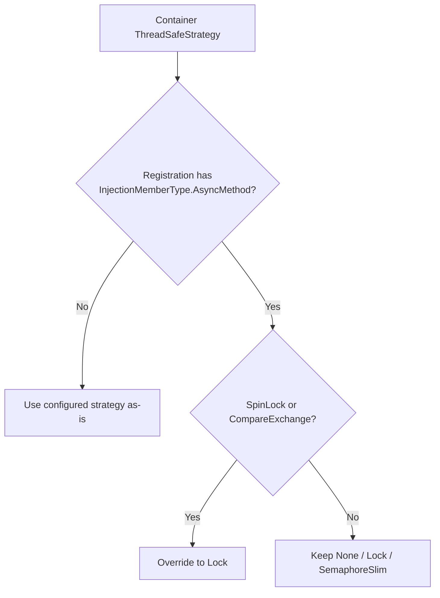

# Thread Safety

## Overview

Service resolution is thread-safe by default using `Lock` with double-checked locking pattern. The strategy can be configured via `ThreadSafeStrategy` property on `[IocContainer]` attribute.

## ThreadSafeStrategy Enum

The `ThreadSafeStrategy` enum controls how the container ensures thread-safe initialization of singleton and scoped services. This only affects services with `Singleton` or `Scoped` lifetime; `Transient` services always create new instances without caching.

|Strategy|Description|Use Case|
|:---|:---|:---|
|`None`|No thread safety. Direct field assignment without synchronization.|Single-threaded applications or when external synchronization is guaranteed. **Warning**: May create multiple instances in multi-threaded scenarios.|
|`Lock`|Uses `lock` statement with double-checked locking pattern. **(Default)**|General-purpose thread safety with balanced performance.|
|`SemaphoreSlim`|Uses `SemaphoreSlim` with double-checked locking pattern.|When concurrent first resolutions of async-init services must wait asynchronously instead of blocking a thread.|
|`SpinLock`|Uses `SpinLock` with double-checked locking pattern.|High-performance scenarios with very short initialization times. Not recommended for I/O-bound initialization.|
|`CompareExchange`|Uses `Interlocked.CompareExchange` (CAS) for lock-free thread safety.|Best performance for lightweight constructors. No synchronization overhead. May create duplicate instances under contention; disposable duplicates are disposed synchronously (never throwing for `IAsyncDisposable`-only instances).|

## Async-init Strategy Override

Registrations that contain one or more `InjectionMemberType.AsyncMethod` members generate async-init resolver paths and cached fields of type `Task<T>`. The synchronization only guards **starting** the task: the slow path stores `CreateXAsync()` in the field, which runs only the synchronous prefix of the creation method (up to its first incomplete `await`) inside the critical section. No `await` ever happens while a `Lock` is held.

Like synchronous resolvers, each async-init resolver is split into a non-`async` expression-bodied fast path (`GetXAsync() => _x ?? ...`) that returns the cached task directly, and a slow path that runs only while the field is `null`:

|Effective strategy|Slow path|
|:---|:---|
|`None`|Inline assignment `(_x = CreateXAsync())`; scoped resolvers use `_x ??= CreateXAsync()`.|
|`Lock`|Non-`async` method `InitXAsync()` returning `_x ??= CreateXAsync()` inside `lock(_xLock)`. Concurrent first resolvers block until the synchronous prefix finishes.|
|`SemaphoreSlim`|`async` method `InitXAsync()` using `WaitAsync()` / `Release()`. Concurrent first resolvers wait asynchronously.|

### Effective Strategy Rules for Async-init Services

|Container `ThreadSafeStrategy`|Effective strategy for async-init field declarations and resolver methods|Required behavior|
|:---|:---|:---|
|`None`|`None`|The generator MUST preserve `None` as-is. This remains an explicit opt-in for single-threaded or externally synchronized usage.|
|`Lock`|`Lock`|The generator MUST preserve `Lock` as-is.|
|`SemaphoreSlim`|`SemaphoreSlim`|The generator MUST preserve `SemaphoreSlim` as-is.|
|`SpinLock`|`Lock`|The generator MUST override the configured strategy to `Lock`, because the critical section runs user initialization code (the synchronous prefix of async inject methods), which is unsuitable for spinning.|
|`CompareExchange`|`Lock`|The generator MUST override the configured strategy to `Lock`, because CAS would start duplicate initializations under contention, running async inject methods more than once.|

> **Scope**: This override applies only to async-init services. Non-async resolver paths MUST continue to use the container's configured `ThreadSafeStrategy`.



### Example: `Lock` Container Strategy with Async-init Service

```csharp
#region Define:
using System.Threading.Tasks;

public interface IAsyncInitializer
{
    Task InitializeAsync(object instance);
}

[IocRegister(ServiceLifetime.Singleton)]
public sealed class MyService
{
    [IocInject]
    public async Task InitializeAsync(IAsyncInitializer initializer)
    {
        await initializer.InitializeAsync(this);
    }
}

[IocContainer(ThreadSafeStrategy = ThreadSafeStrategy.Lock)]
public partial class AppContainer;
#endregion

#region Generate:
partial class AppContainer
{
    private global::System.Threading.Tasks.Task<global::MyService>? _myService;
    private global::System.Threading.Lock? _myServiceLock;

    // Non-async fast path: an already-started task (or the root's) is returned without allocating.
    private global::System.Threading.Tasks.Task<global::MyService> GetMyServiceAsync() => _myService ?? _root?.GetMyServiceAsync() ?? InitMyServiceAsync();

    // Non-async slow path: only starts the task inside the lock; nothing is awaited while holding it.
    private global::System.Threading.Tasks.Task<global::MyService> InitMyServiceAsync()
    {
        lock(_myServiceLock ?? __CreateLock(ref _myServiceLock))
        {
            return _myService ??= CreateMyServiceAsync();
        }
    }
}
#endregion
```

With `ThreadSafeStrategy.SemaphoreSlim`, the field is guarded by `SemaphoreSlim` and the slow path waits asynchronously:

```csharp
private global::System.Threading.SemaphoreSlim? _myServiceSemaphore;

private async global::System.Threading.Tasks.Task<global::MyService> InitMyServiceAsync()
{
    await (_myServiceSemaphore ?? __CreateSemaphore(ref _myServiceSemaphore)).WaitAsync().ConfigureAwait(false);
    try
    {
        if(_myService is null)
        {
            _myService = CreateMyServiceAsync();
        }
    }
    finally
    {
        _myServiceSemaphore!.Release();
    }

    return await _myService.ConfigureAwait(false);
}
```

```csharp
// Invalid outcome (must not happen): the resolver must not be async, and the task must not be awaited while synchronizing.
private async global::System.Threading.Tasks.Task<global::MyService> GetMyServiceAsync()
{
    if(_myService is not null)
        return await _myService.ConfigureAwait(false);
    ...
}
```

## Generated Code Examples

Every synchronous singleton/scoped resolver is split into an expression-bodied fast path (`GetX() => _x ?? CreateX();`) and a slow-path `CreateX()`. Strategies differ only in the body of `CreateX()`; for singletons it starts with `if(_root is not null) return _root.GetX();` (see [Lifetime](Container.Lifetime.spec.md)).

### ThreadSafeStrategy.None

No synchronization primitives. Simple but not thread-safe:

```csharp
private global::MyService? _myService;
private global::MyService GetMyService() => _myService ?? CreateMyService();

private global::MyService CreateMyService()
{
    var instance = new global::MyService();
    _myService = instance;
    return instance;
}
```

### ThreadSafeStrategy.Lock (Default)

Uses `Lock` class with double-checked locking:

```csharp
private global::MyService? _myService;
private Lock? _myServiceLock;
private global::MyService GetMyService() => _myService ?? CreateMyService();

private global::MyService CreateMyService()
{
    lock (_myServiceLock ?? __CreateLock(ref _myServiceLock))
    {
        if (_myService is not null) return _myService;

        var instance = new global::MyService();
        _myService = instance;
        return instance;
    }
}
```

### ThreadSafeStrategy.SemaphoreSlim

Uses `SemaphoreSlim` with double-checked locking:

```csharp
private global::MyService? _myService;
private SemaphoreSlim? _myServiceSemaphore;
private global::MyService GetMyService() => _myService ?? CreateMyService();

private global::MyService CreateMyService()
{
    (_myServiceSemaphore ?? __CreateSemaphore(ref _myServiceSemaphore)).Wait();
    try
    {
        if (_myService is not null) return _myService;

        var instance = new global::MyService();
        _myService = instance;
        return instance;
    }
    finally
    {
        _myServiceSemaphore!.Release();
    }
}
```

### ThreadSafeStrategy.SpinLock

Uses `SpinLock` with double-checked locking. Note that `SpinLock` is a struct and must not be readonly:

```csharp
private global::MyService? _myService;
private SpinLock _myServiceSpinLock = new(false);
private global::MyService GetMyService() => _myService ?? CreateMyService();

private global::MyService CreateMyService()
{
    bool lockTaken = false;
    try
    {
        _myServiceSpinLock.Enter(ref lockTaken);
        if (_myService is not null) return _myService;

        var instance = new global::MyService();
        _myService = instance;
        return instance;
    }
    finally
    {
        if (lockTaken) _myServiceSpinLock.Exit();
    }
}
```

### ThreadSafeStrategy.CompareExchange

Uses `Interlocked.CompareExchange` for lock-free CAS (Compare-And-Swap) pattern. No synchronization field needed. Under contention, multiple instances may be created but only one is retained; losing instances that implement `IDisposable` are disposed (resolution never throws for `IAsyncDisposable`-only instances):

```csharp
private global::MyService? _myService;
private global::MyService GetMyService() => _myService ?? CreateMyService();

private global::MyService CreateMyService()
{
    var instance = new global::MyService();

    var existing = Interlocked.CompareExchange(ref _myService, instance, null);
    if(existing is not null)
    {
        ((object)instance as global::System.IDisposable)?.Dispose();
        return existing;
    }
    return instance;
}
```

## Field Generation by Strategy

Each strategy generates different synchronization fields:

|Strategy|Instance Field|Synchronization Field|Disposed|
|:---|:---|:---|:---|
|`None`|`private T? _field;`|None|N/A|
|`Lock`|`private T? _field;`|`private Lock? _fieldLock;` (allocated on first use)|No (no unmanaged resources)|
|`SemaphoreSlim`|`private T? _field;`|`private SemaphoreSlim? _fieldSemaphore;` (allocated on first use)|**Yes** (in `Dispose`/`DisposeAsync`, when allocated: `_fieldSemaphore?.Dispose();`)|
|`SpinLock`|`private T? _field;`|`private SpinLock _fieldSpinLock = new(false);` (not readonly)|No (value type)|
|`CompareExchange`|`private T? _field;`|None|No|

> **Note**: Eager singletons use non-nullable fields (`private T _field;`) without synchronization fields, as the root constructor creates them before the container can be used from other threads. Eager scoped services MUST keep the synchronized shape above: scope constructors create them, but the root creates them on demand, possibly from several threads.

**Synchronization allocated on first use**: `Lock` and `SemaphoreSlim` fields MUST NOT be allocated by a field initializer, which every scope would run. The slow path MUST allocate the field on first use with the static helpers below, which agree on one instance through `Interlocked.CompareExchange`; a container emits a helper only when some entry uses its strategy. A scope (or the root) thus allocates synchronization only for the services it creates: never for singletons in scopes, which delegate creation to the root, and never for scoped services a scope does not resolve. The slow path MUST NOT keep the primitive in a local variable, which could hide a container member referenced by a user expression in the creation code (e.g. a `KeyType.Csharp` key); it re-reads the field (`_fieldSemaphore!.Release()`), which is never reset. A losing `SemaphoreSlim` is dropped undisposed (it holds no unmanaged resource until `AvailableWaitHandle` is used). `SpinLock` fields are value types and keep their initializer.

```csharp
private static global::System.Threading.Lock __CreateLock(ref global::System.Threading.Lock? field)
{
    var created = new global::System.Threading.Lock();
    return global::System.Threading.Interlocked.CompareExchange(ref field, created, null) ?? created;
}

private static global::System.Threading.SemaphoreSlim __CreateSemaphore(ref global::System.Threading.SemaphoreSlim? field)
{
    var created = new global::System.Threading.SemaphoreSlim(1, 1);
    return global::System.Threading.Interlocked.CompareExchange(ref field, created, null) ?? created;
}
```

## Scope Constructor Behavior

When creating a child scope, synchronization fields are NOT copied from parent. Each scope allocates its own synchronization primitives for the scoped services it creates (see above):

```csharp
private AppContainer(AppContainer parent, IIocFallbackScopeOwner? fallbackScopeOwner)
{
    _fallbackProvider = parent._fallbackProvider;
    _fallbackScopeOwner = fallbackScopeOwner;
    _isRootScope = false;
    _root = parent._root ?? parent;

    // Copy singleton instance references from parent (both eager and lazy).
    // A lazy singleton not yet created is null here; its resolver then delegates to _root,
    // so singleton synchronization always happens on the root's fields.
    _eagerSingletonService = parent._eagerSingletonService;
    _lazySingletonService = parent._lazySingletonService;

    // Scoped fields are fresh for each scope (both instance and sync fields)

    // Initialize Lazy/Func wrapper fields, then eager scoped services
    _lazy_IMyService_MyService = new global::System.Lazy<global::IMyService>(() => GetMyService(), global::System.Threading.LazyThreadSafetyMode.ExecutionAndPublication);
    GetEagerScopedService();
}
```

## See Also

- [Service Lifetime Management](Container.Lifetime.spec.md)
- [Container Options](Container.Options.spec.md)
